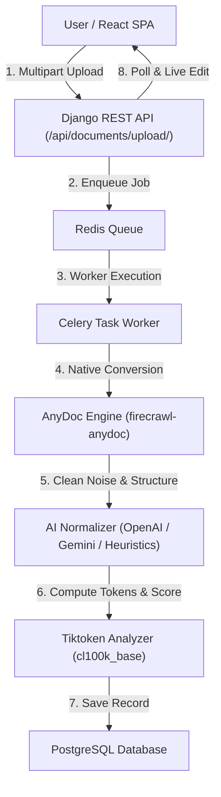

<div align="center">

# ⚡ AiDoc2MD

**AI-Powered Document-to-Markdown Converter & Token-Efficiency Studio**

[](https://opensource.org/licenses/MIT)
[](https://www.python.org/)
[](https://www.djangoproject.com/)
[](https://reactjs.org/)
[](https://vitejs.dev/)
[](https://tailwindcss.com/)
[](https://www.docker.com/)

---

AiDoc2MD converts multi-format documents (PDF, DOCX, XLSX, PPTX, CSV, RTF, EPUB, ODF, TXT) into LLM-optimized Markdown, eliminates boilerplate noise, repairs broken tables, and measures exact token savings using `tiktoken`.

[Quick Start](#-quick-start) • [Architecture](#-system-architecture) • [API Reference](#-api-reference) • [Vercel Deployment](#-vercel-deployment) • [Developer](#-author--credits)

<br/>


</div>

---


## 📑 Table of Contents

- [Overview](#-overview)
- [Why AiDoc2MD?](#-why-aidoc2md)
- [Key Features](#-key-features)
- [Tech Stack](#-tech-stack)
- [System Architecture](#-system-architecture)
- [Project Structure](#-project-structure)
- [Quick Start](#-quick-start)
- [Prerequisites](#-prerequisites)
- [Installation & Setup](#-installation--setup)
- [Environment Variables](#-environment-variables)
- [API Reference](#-api-reference)
- [Vercel Deployment](#-vercel-deployment)
- [Testing & Verification](#-testing--verification)
- [Author & Credits](#-author--credits)
- [License](#-license)

---

## 🔍 Overview

**AiDoc2MD** is a developer-grade document ingestion and token-optimization workspace built for Retrieval-Augmented Generation (RAG), LLM context management, and document processing pipelines. 

Raw text extractions from PDFs, spreadsheets, and documents often contain pagination boilerplate, broken ligatures (`fi`, `fl`), unaligned table pipes, and trailing whitespace. AiDoc2MD ingests these files using **AnyDoc** (`firecrawl-anydoc` / `@firecrawl/anydoc-wasm`), applies a modular **AI Normalization Layer**, and calculates exact byte-pair token savings (`cl100k_base`) alongside a 4-pillar **AI Readiness Score (0–100)**.

---

## 💡 Why AiDoc2MD?

- **Eliminate Context Window Bloat**: Save 20%–45% of LLM prompt budgets by stripping scan noise, page numbers, and repeating headers.
- **Table Integrity**: Converts messy CSV and Excel rows into clean GitHub Flavored Markdown (GFM) tables.
- **Authoritative Conversion with AnyDoc**: Ultra-fast native conversion across PDF, DOCX, XLSX, PPTX, CSV, EPUB, RTF, and ODF formats.
- **Zero-Key Heuristic Fallback**: Operates out-of-the-box with a high-speed deterministic normalizer, or connects to **OpenAI GPT-4o** and **Google Gemini 1.5**.
- **Developer-First UI**: Cinematic obsidian split-screen editor, live preview, diff viewer, radial readiness gauge, and PDF/MD export hub.

---

## ✨ Key Features

- 📂 **Multi-Format Ingestion with AnyDoc**: Ingests PDF, DOCX, XLSX, PPTX, CSV, RTF, EPUB, ODT, ODS, ODP, and TXT files.
- 🧹 **AI Normalization Engine**: Reconstructs tables, standardizes list bullet points, normalizes heading hierarchies (`#`, `##`, `###`), and formats code blocks.
- ⚡ **Tiktoken Precision & AI Readiness Score (0–100)**: Evaluates documents across 4 dimensions:
  1. **Structure Score (30%)**: Heading depth, valid GFM tables, code fences.
  2. **Cleanliness Score (30%)**: Elimination of pagination noise and control characters.
  3. **Token Density Score (25%)**: Ratio of informative content vs syntactic bloat.
  4. **Semantic Clarity Score (15%)**: Balanced line wrapping and sentence boundaries.
- 🪟 **Split-Screen Workspace**: Side-by-side editable Markdown source with line numbers, live GFM rendered preview, and unified/line diff viewer.
- 📦 **Export Hub**: 1-click Copy Markdown, Download `.md`, and export styled PDF reports.
- 📜 **Conversion History**: Persistent PostgreSQL history drawer with search and file-type filters.

---

## 🛠️ Tech Stack

| Category | Technology | Role / Usage |
| :--- | :--- | :--- |
| **Frontend** | React 18, TypeScript, Vite, Tailwind CSS | Single Page Application, Monaco/line editor, live GFM preview, Framer Motion animations |
| **Backend API** | Python 3.12+, Django 5.2, Django REST Framework | RESTful endpoints, file upload processing, metric calculation, PDF generation |
| **Conversion Engine** | Firecrawl `anydoc` (`firecrawl-anydoc` / `@firecrawl/anydoc-wasm`) | Primary & authoritative document parser converting PDF, DOCX, XLSX, PPTX, CSV, RTF, EPUB, ODF to Markdown |
| **AI Layer** | `openai`, `google-generativeai`, `HeuristicRuleCleaner` | Modular normalizer running OpenAI GPT-4o, Gemini 1.5 Flash, or deterministic rules |
| **Token Analyzer** | `tiktoken` (`cl100k_base` / `o200k_base`) | Byte-pair encoding tokenizer for exact token accounting and cost estimation |
| **Async Tasks** | Celery 5.6, Redis 7 | Asynchronous background processing queue (with eager fallback for local dev) |
| **Database** | PostgreSQL 16 (or SQLite fallback) | Stores document metadata, raw text, clean Markdown, and readiness metrics |
| **PDF Export** | ReportLab 5.0 | Server-side PDF report compilation |
| **Containers** | Docker & Docker Compose | Containerized multi-service orchestration |

---

## 🏗️ System Architecture



---

## 📁 Project Structure

```
AiDoc2MD/
├── backend/
│   ├── manage.py
│   ├── requirements.txt
│   ├── Dockerfile
│   ├── pytest.ini
│   ├── verify_demo.py               # End-to-end pipeline verification script
│   ├── aidoc2md/
│   │   ├── settings.py              # Django & Celery configuration
│   │   ├── urls.py
│   │   └── celery.py
│   └── documents/
│       ├── models.py                # Document database schema
│       ├── views.py                 # REST API endpoints
│       ├── tasks.py                 # Celery background tasks
│       ├── serializers.py
│       └── services/
│           ├── converter.py         # MarkItDown + fallback parsers
│           ├── ai_cleaner.py        # Modular AI & Heuristic normalizer
│           ├── tokenizer.py         # Tiktoken & Readiness Score engine
│           └── exporter.py          # ReportLab PDF exporter
├── frontend/
│   ├── package.json
│   ├── vite.config.ts
│   ├── vercel.json                  # Vercel deployment config for frontend
│   ├── src/
│   │   ├── App.tsx                  # Main state coordinator
│   │   ├── components/
│   │   │   ├── Header.tsx           # Navbar & Developer credit chip
│   │   │   ├── FileUploader.tsx     # Drag-and-drop zone with sample loaders
│   │   │   ├── DocumentWorkspace.tsx# Split-screen workbench
│   │   │   ├── SplitEditor.tsx      # Editable Markdown source with line numbers
│   │   │   ├── MarkdownPreview.tsx  # GFM preview with syntax highlight
│   │   │   ├── TokenAnalytics.tsx   # Token cards & cost savings
│   │   │   ├── ReadinessScoreBadge.tsx # Radial score gauge (0-100)
│   │   │   ├── DiffViewer.tsx       # Line & word diff viewer
│   │   │   └── HistoryDrawer.tsx    # Conversion history drawer
│   │   ├── api/client.ts
│   │   └── utils/formatters.ts
├── docker-compose.yml
├── vercel.json                      # Monorepo root Vercel configuration
├── .env.example
└── README.md
```

---

## ⚡ Quick Start

```bash
# 1. Clone the repository
git clone https://github.com/Rahil-dope/AiDoc2MD.git
cd AiDoc2MD

# 2. Copy environment file
cp .env.example .env

# 3. Launch with Docker Compose
docker-compose up --build
```

Access:
- **Frontend SPA**: [http://localhost:3000](http://localhost:3000)
- **Django REST API**: [http://localhost:8000/api/](http://localhost:8000/api/)
- **API Health Check**: [http://localhost:8000/api/health/](http://localhost:8000/api/health/)

---

## ⚙️ Prerequisites

- **Docker & Docker Compose**: v20.10+ (for containerized deployment)
- **Python**: v3.12+ (for local backend development)
- **Node.js**: v20+ & **npm** v10+ (for local frontend development)

---

## 🚀 Local Installation & Setup

### 1. Backend Setup

```bash
cd backend

# Create virtual environment
python -m venv venv

# Activate virtual environment
# Windows PowerShell:
.\venv\Scripts\Activate.ps1
# Linux/macOS:
source venv/bin/activate

# Install backend dependencies
pip install -r requirements.txt

# Run migrations (defaults to SQLite if PostgreSQL env variables are omitted)
python manage.py makemigrations documents
python manage.py migrate

# Start backend server
python manage.py runserver 8000
```

### 2. Frontend Setup

```bash
cd frontend

# Install frontend dependencies
npm install

# Start Vite development server
npm run dev
```

Open [http://localhost:5173](http://localhost:5173) in your browser.

---

## 🔑 Environment Variables

| Variable | Required | Description | Default |
| :--- | :---: | :--- | :--- |
| `DEBUG` | No | Django debug mode | `True` |
| `SECRET_KEY` | No | Django secret key | `django-insecure-...` |
| `POSTGRES_DB` | No | PostgreSQL database name | `aidoc2md` |
| `POSTGRES_USER` | No | PostgreSQL username | `aidoc2md` |
| `POSTGRES_PASSWORD` | No | PostgreSQL password | `aidoc2md_secure_pass` |
| `POSTGRES_HOST` | No | PostgreSQL host address | `db` |
| `CELERY_BROKER_URL` | No | Redis broker URI | `redis://redis:6379/0` |
| `OPENAI_API_KEY` | No | (Optional) OpenAI API Key for GPT-4o cleaning | `""` |
| `GEMINI_API_KEY` | No | (Optional) Google Gemini API Key | `""` |
| `AI_DEFAULT_PROVIDER` | No | AI cleaning provider (`auto`, `openai`, `gemini`, `heuristic`) | `auto` |
| `VITE_API_BASE_URL` | No | Frontend API Base URL | `/api` |

---

## 📡 API Reference

### Health Check
```http
GET /api/health/
```
**Response (200 OK):**
```json
{
  "status": "healthy",
  "service": "AiDoc2MD API",
  "version": "1.0.0",
  "features": {
    "anydoc": true,
    "tiktoken_analysis": true,
    "ai_normalization": true,
    "pdf_export": true
  }
}
```

### Upload Document
```http
POST /api/documents/upload/
Content-Type: multipart/form-data
```
| Parameter | Type | Required | Description |
| :--- | :--- | :---: | :--- |
| `file` | File | **Yes** | Document file (PDF, DOCX, XLSX, PPTX, CSV, RTF, EPUB, ODF, TXT) |
| `title` | String | No | Custom document title |
| `custom_ai_instructions` | String | No | Custom prompts for AI cleaner |
| `preferred_provider` | String | No | Provider override (`auto`, `openai`, `gemini`, `heuristic`) |

### List Document History
```http
GET /api/documents/
```

### Fetch Document Details
```http
GET /api/documents/<uuid:id>/
```

### Update User Markdown
```http
PATCH /api/documents/<uuid:id>/
Content-Type: application/json

{
  "user_edited_markdown": "# Updated Document Title\n\n- Bullet item"
}
```

### Export PDF
```http
GET /api/documents/<uuid:id>/export/pdf/
```

---

## 🌐 Vercel Deployment

AiDoc2MD comes pre-configured with root and frontend `vercel.json` configurations for instant deployment on [Vercel](https://vercel.com).

### Deploy Frontend on Vercel:
1. Import repository `Rahil-dope/AiDoc2MD` in Vercel Dashboard.
2. Set Root Directory to `frontend`.
3. Build Command: `npm run build`
4. Output Directory: `dist`
5. Click **Deploy**.

For full stack Vercel deployments, configure `VITE_API_BASE_URL` in environment variables pointing to your hosted Django backend.

---

## 🧪 Testing & Verification

Run the full pytest suite for backend converters, tokenizers, normalizers, and API endpoints:

```bash
cd backend
.\venv\Scripts\pytest -v
```

**Verification Output:**
```
documents/tests/test_api.py::test_document_upload_and_list PASSED        [ 10%]
documents/tests/test_api.py::test_image_upload_rejected PASSED           [ 20%]
documents/tests/test_ai_cleaner.py::test_heuristic_cleaning PASSED       [ 30%]
documents/tests/test_ai_cleaner.py::test_ai_cleaner_fallback PASSED      [ 40%]
documents/tests/test_converter.py::test_converter_text_file PASSED       [ 50%]
documents/tests/test_converter.py::test_converter_csv_file PASSED        [ 60%]
documents/tests/test_converter.py::test_converter_rejects_image_files PASSED [ 70%]
documents/tests/test_tokenizer.py::test_token_counting PASSED            [ 80%]
documents/tests/test_tokenizer.py::test_token_analysis_metrics PASSED    [ 90%]
documents/tests/test_tokenizer.py::test_readiness_score_pillars PASSED   [100%]

============================= 10 passed in 0.90s ==============================
```

---

## 👤 Author & Credits

### Lead Developer

**Shaikh Rahil Hussain**  
- **GitHub**: [@Rahil-dope](https://github.com/Rahil-dope)
- **LinkedIn**: [Shaikh Rahil Hussain](https://www.linkedin.com/in/shaikh-rahil-hussain-a54348291)
- **Email**: [rahilhussain431601@gmail.com](mailto:rahilhussain431601@gmail.com)

---

## 📄 License

This project is licensed under the **MIT License**. See the [LICENSE](LICENSE) file for details.

---

<div align="center">

Made with ❤️ by **Shaikh Rahil Hussain** • Powered by Firecrawl AnyDoc & OpenAI Tiktoken

</div>
